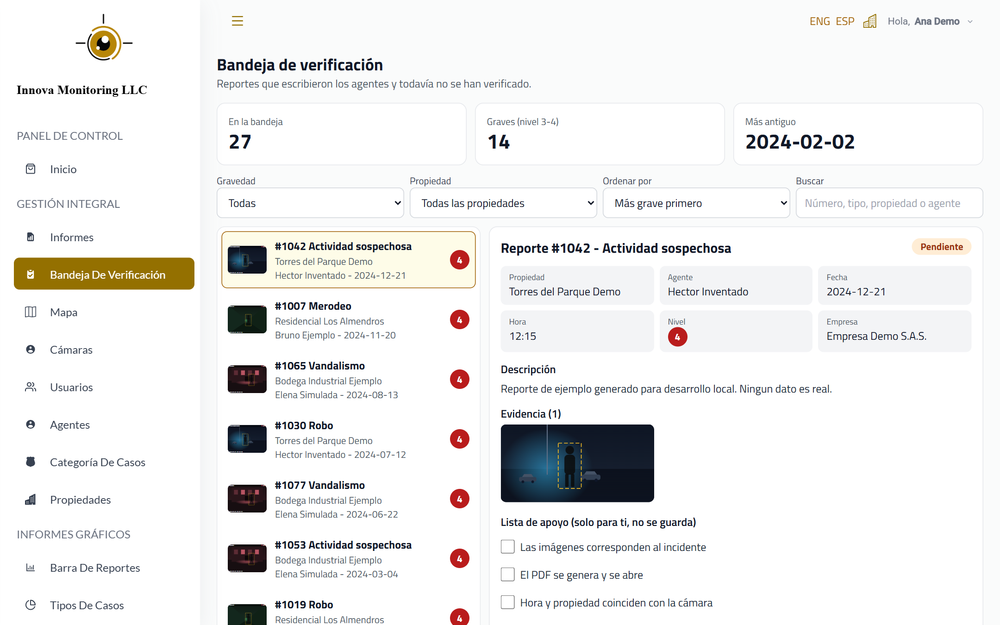
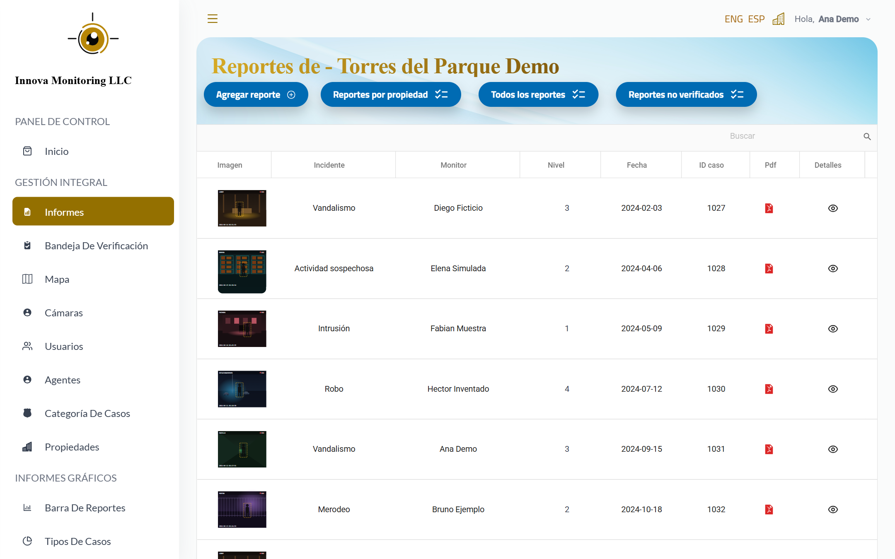
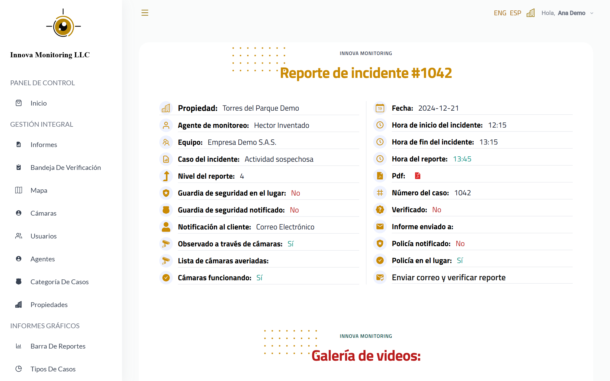
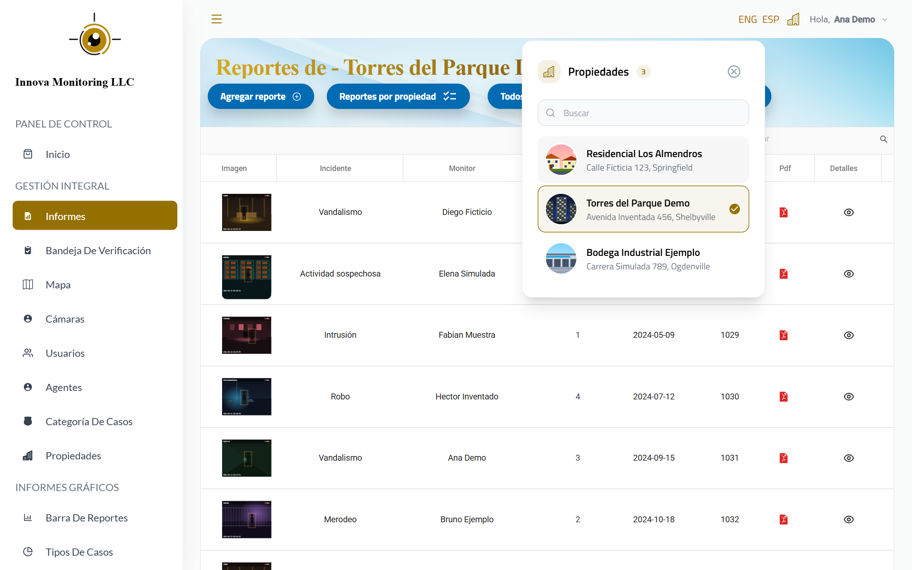
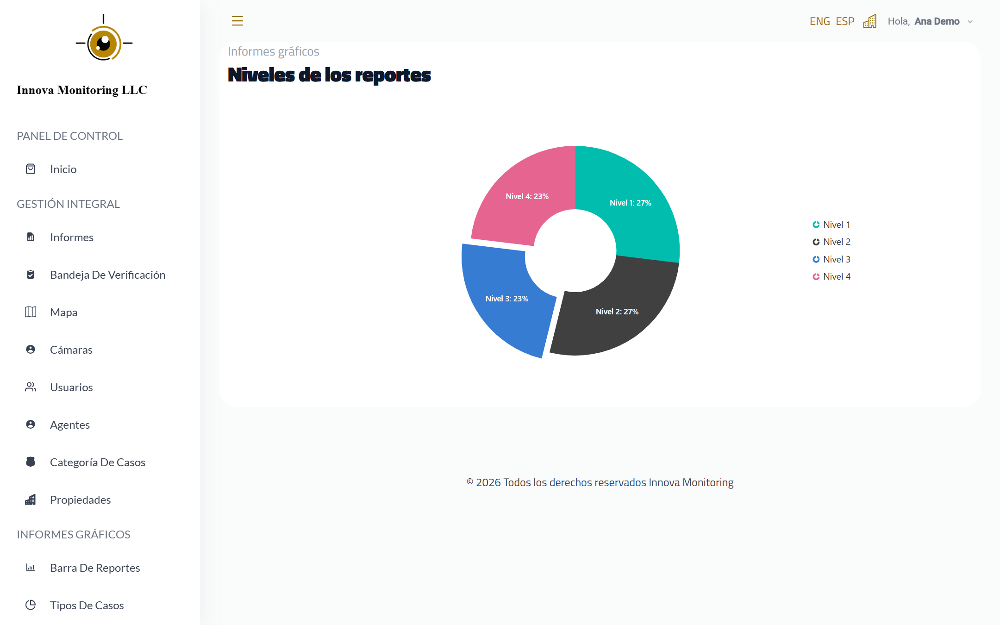
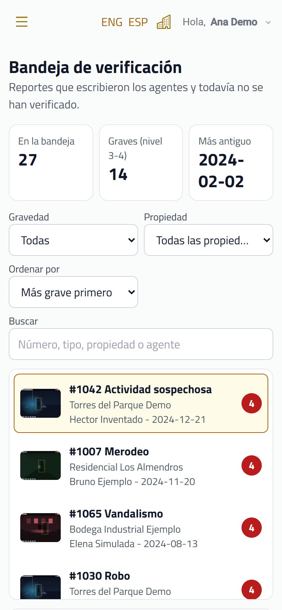
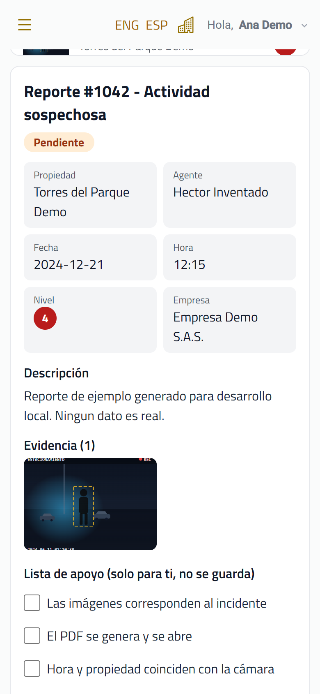
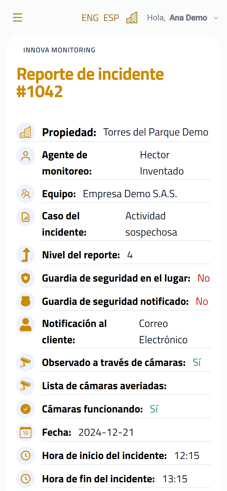
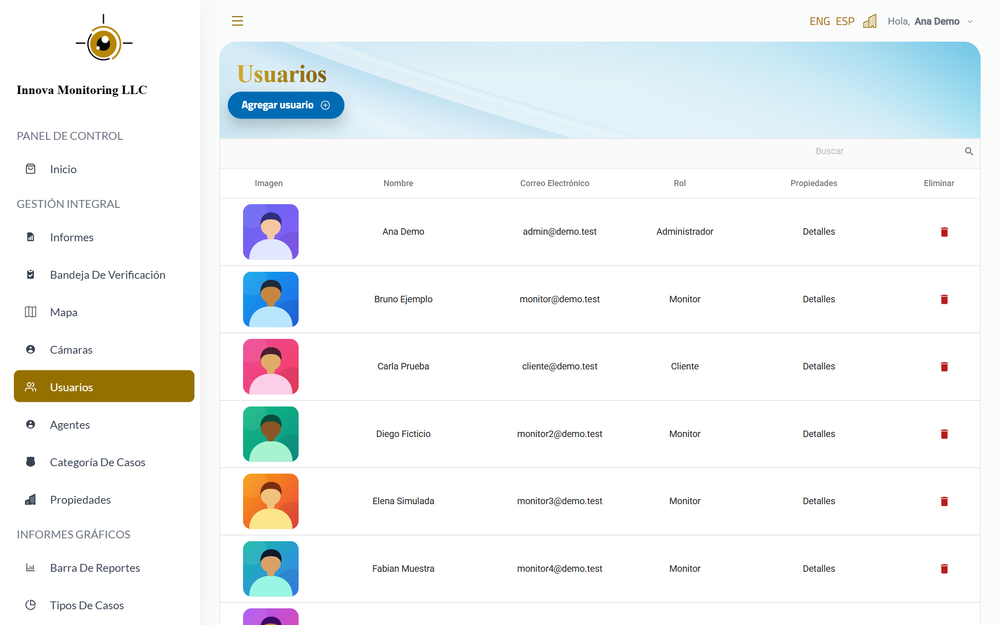
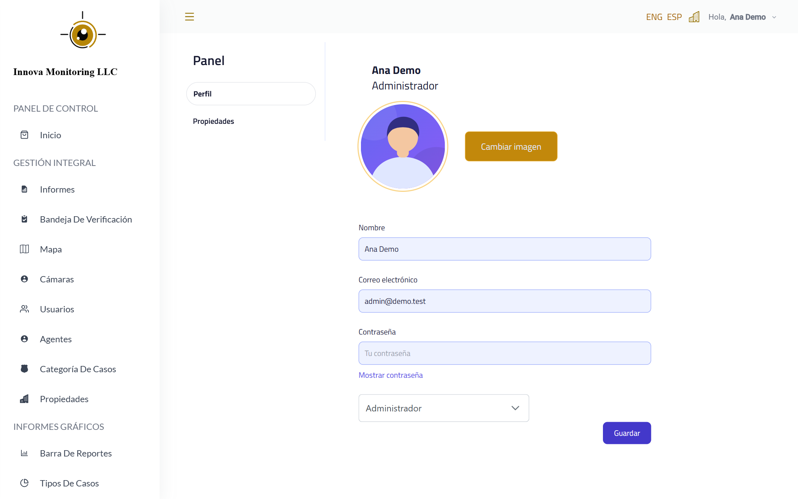

# InnovaMonitoring: caso de estudio

Panel web para una empresa de monitoreo de seguridad. Los agentes vigilan cámaras en varias propiedades, escriben un reporte cada vez que pasa algo (un robo, vandalismo, alguien merodeando) y un administrador revisa esos reportes antes de enviarlos al cliente.

Este repositorio es un caso de estudio. El código de la aplicación es privado; aquí se explica qué hace, cómo está pensada y cómo se ve.

Todas las capturas se tomaron con datos inventados (empresas, personas, direcciones e imágenes de ejemplo). Ninguna muestra datos reales de clientes.

## El problema

Una empresa de monitoreo maneja muchos reportes, en muchas propiedades, escritos por varios agentes. Sin una herramienta común es difícil saber cuántos reportes hay por propiedad, cuáles faltan por revisar y qué cámaras están fallando. La empresa necesitaba un solo lugar para:

- Registrar cada incidente con su evidencia (fotos, videos y PDF).
- Revisar y verificar los reportes antes de que lleguen al cliente.
- Saber el estado de las cámaras de cada propiedad.
- Ver números simples por mes, por tipo de caso y por gravedad.

## Qué hace la aplicación

### Bandeja de verificación

Es la pantalla de trabajo del administrador. A la izquierda están los reportes que todavía no se han verificado, con los más graves primero. A la derecha está el detalle del reporte elegido: datos del incidente, evidencia y una lista de apoyo para revisar antes de verificar. Se puede filtrar por gravedad y por propiedad, y buscar por número, tipo o agente.

### Reportes

La tabla de reportes muestra la imagen principal de cada incidente, el agente que lo escribió, el nivel de gravedad, la fecha y accesos directos al PDF y al detalle.

El detalle reúne toda la información del incidente: propiedad, agente, horas, si se avisó a la policía o a los guardas, cámaras afectadas y la galería de evidencias, que se puede descargar.

### Cambio de propiedad

Desde la barra superior se cambia de propiedad sin salir de la pantalla. El panel tiene un buscador por nombre o dirección y marca la propiedad que se está viendo.

### Gráficas

Gráficas por tipo de incidente, por nivel de gravedad y por mes, para ver de un vistazo cómo va cada propiedad.

### En el celular

La aplicación se usa también desde el teléfono. En la bandeja, la lista queda arriba y el detalle debajo; cada fila es fácil de tocar.

| Bandeja | Detalle en la bandeja | Detalle del reporte |
|---|---|---|
|  |  |  |

### Usuarios y perfil

El administrador ve a todos los usuarios con su correo y su rol, consulta las propiedades de cada uno y desde ahí los agrega o elimina.

Cada persona tiene su página de perfil, a la que llega haciendo clic en su nombre en la barra superior. Ahí cambia su imagen, su nombre, su correo y su contraseña.

## Otras funciones

- Usuarios con roles distintos: administrador, agente de monitoreo y cliente. Cada uno ve solo lo que le corresponde.
- Gestión de cámaras, agentes, propiedades y categorías de casos.
- Formulario para crear y editar reportes, con carga de evidencias.
- Generación del reporte en PDF y descarga de todas las evidencias en un archivo comprimido.
- Envío del reporte por correo al cliente.
- Mapa de cada propiedad con la ubicación de sus cámaras.
- La interfaz está en español y en inglés.

## Tecnologías

- React 18 con React Router.
- Tailwind CSS, con componentes de Syncfusion (tablas y gráficas), PrimeReact y Material UI.
- i18next para los dos idiomas.
- Leaflet para los mapas.
- jsPDF, html2canvas y JSZip para el PDF y la descarga de evidencias.
- EmailJS para el envío de correos.
- La aplicación consume una API REST propia; las imágenes se guardan en un almacenamiento en la nube.

## Modo local con datos de ejemplo

Para trabajar sin depender del servidor real, la aplicación tiene un modo local que reemplaza la API por una falsa con datos inventados. En ese modo no se hace ninguna llamada a servicios externos: ni a la API, ni al almacenamiento de imágenes, ni a mapas, ni al correo. Las capturas de este caso de estudio se tomaron así.
